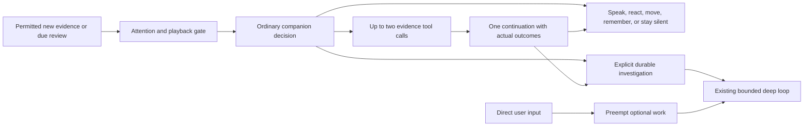

# Capri companion architecture: November 12, 2026

## Decision

Keep Capri's Windows application, attributed experience archive, canonical state,
permission checks, character guide and native movement. Replace the default
Runtime 2 ordinary-decision contract with a companion path that can read a little
evidence without first creating a durable investigation. Add local dialogue
recall and playback-aware scheduling. Ship the opt-in path in 1.6.0 on
`feature/companion-evidence-loop`.

OpenAmika provides useful companion mechanisms, but source inspection does not
establish that its whole architecture or its models produce a superior Capri.
Replacing the application would also mean replacing working Windows embodiment
and integrating a Python service stack. This review therefore implements the
useful mechanisms directly in Capri, with no new runtime dependency, downloaded
model, borrowed character or memory migration.

The user's one-hour scope favors a complete, reviewable slice over a speculative
rewrite. Existing research already covered YUI, AIRI, Hermes, Neural Companion,
Honcho, Mem0, Letta and SQLite-vec. The additional source reviews here are
OpenAmika, N.E.K.O. and Warashi. These projects were inspected, not installed or
benchmarked against Capri.

## How OpenAmika works

Inspected revision: `9e38a51f333cb4b5f36d026f2d87903f91f30516`.

1. **Service orchestration.** `launch.py` checks and starts separately configured
   services: an optional local embedder, a Flask/Socket.IO brain, optional visual
   description and speech. The browser/desktop-pet interface displays a Live2D
   character. SenseVoice, GPT-SoVITS, BGE-M3 and optional Qwen vision are separate
   model components; OpenRouter and Ollama provide language-model routes.
2. **Surface and deeper conversation.** `brain/webui.py` streams a small surface
   response and parses its mode. A direct `say` can finish there; `think` and
   `say+think` continue to deeper generation. Turn IDs correlate output and
   playback. Protected turns represent committed output, and later user input
   cancels speculative work. `brain/f_roles.py` configures distinct model roles.
   The checked-in protocol contains older model descriptions, so live source
   and configuration control this analysis.
3. **Evidence-backed recall before generation.** `brain/f_bridge.py` retrieves
   relevant memory once per turn, excludes events already in recent history and
   renders the same retrieval at different surface/deep budgets. In the checked
   configuration these are 2,000 and 3,600 characters. A stepped recent-history
   window is intended to keep provider-cache prefixes stable.
4. **Originals alongside extracted facts.** `brain/f_method.py` ranks facts and
   original events using hybrid retrieval. Fact packets retain supporting quotes
   and linked corrections. Whole packets must fit; a claim cannot shed its
   correction merely to satisfy the budget. The renderer reserves space for
   original speech before fitting fact packets. `brain/f_memory.py` runs the
   persistent extraction/embedding work separately. This is more than a simple
   rolling chat summary, and is also a larger model/service commitment.
5. **Initiative and interruption.** Configuration enables idle reflection and
   reflection-initiated speech. Playback markers anchor silence timing to the
   end of audible speech, rather than the end of text generation. The bridge
   cancels work across conversation and reflection on interruption/reset.
6. **Accounting and tools.** Usage receipts distinguish phases, incomplete usage
   and settlement. Optional helper bridges provide errands/tools. Adding these
   wholesale to Capri would create another tool/permission boundary rather than
   directly solve its observed passivity.

Sources: [launcher](https://github.com/zeekk0/OpenAmika/blob/9e38a51f333cb4b5f36d026f2d87903f91f30516/launch.py),
[conversation](https://github.com/zeekk0/OpenAmika/blob/9e38a51f333cb4b5f36d026f2d87903f91f30516/brain/webui.py),
[memory bridge](https://github.com/zeekk0/OpenAmika/blob/9e38a51f333cb4b5f36d026f2d87903f91f30516/brain/f_bridge.py),
[memory packets](https://github.com/zeekk0/OpenAmika/blob/9e38a51f333cb4b5f36d026f2d87903f91f30516/brain/f_method.py),
[configuration](https://github.com/zeekk0/OpenAmika/blob/9e38a51f333cb4b5f36d026f2d87903f91f30516/config/build_f.json).

## Additional projects and choices

| Project | Source mechanism | Capri decision |
| --- | --- | --- |
| OpenAmika | Lightweight surface decisions; evidence available before deeper work; whole attributed memory packets | Make small evidence reads ordinary, and provide bounded original dialogue recall. Preserve Capri's existing model/provider and canonical archive. |
| N.E.K.O. | A proactive delivery manager waits for frontend playback completion, coalesces explicit keys, applies priority, bounds queues and expires stale cues | Connect existing renderer speech receipts to the Runtime 2 scheduler. Capri already batches observation sources and gives direct input priority; do not add a competing delivery queue. |
| Warashi | Optional SQLite FTS5 recall of old dialogue, bounded snippets and literal query construction; recall errors cannot take down chat | Search Capri's existing FTS journal, preserve original speaker/time, exclude recent context, bound whole recovered records and fail softly. No embedding process or duplicate index. |

N.E.K.O. inspected revision: `a8e9b5d51337d5173b77b3819f867f1e9315bc1a`.
[Delivery manager](https://github.com/Project-N-E-K-O/N.E.K.O/blob/a8e9b5d51337d5173b77b3819f867f1e9315bc1a/main_logic/proactive_delivery.py).

Warashi inspected revision: `8c71103978dbd34b8595af34eefd14c3028655f6`.
[Local recall](https://github.com/inni918/warashi/blob/8c71103978dbd34b8595af34eefd14c3028655f6/src/open_llm_vtuber/memory_fts.py),
[proactive trigger](https://github.com/inni918/warashi/blob/8c71103978dbd34b8595af34eefd14c3028655f6/src/open_llm_vtuber/conversations/conversation_handler.py).
Its generic proactive prompt can request speech and mark proactive turns to skip
history/memory. Capri retains silence and archives its actual expressed views;
those Warashi behaviors were not adopted.

OpenAmika and Warashi source carry MIT licenses; N.E.K.O. carries Apache-2.0.
OpenAmika's character, voice and Live2D assets have additional terms. This change
is an original implementation of architectural ideas: no external source,
persona, artwork, voice or model weights were copied into Capri.

## Implemented behavior

### One owner, two sizes of work

- Runtime 2 defaults to `companion`. The previous `two-speed`, `lean` and
  `layered` modes remain explicit development comparisons.
- The first ordinary request can use at most two calls among original recovery,
  archive search, canonical-memory search, current Chrome page reading, window
  inspection and capture. Each call retains the existing validation, permissions,
  image limits, disclosure mode and native capability receipt.
- A read, even one that fails, permits one outcome-aware continuation. Ordinary
  reads are removed from that continuation. Further unoffered calls earn denied
  receipts; they do not open another request. Actions without reads need one
  inference, without an automatic finishing inference.
- A successfully persisted `investigate` call can explicitly open the existing
  deep loop. A malformed/denied escalation cannot. Due investigations retain
  their existing path. The overall six-request cycle ceiling and HTTP-level
  session/hour/token admission remain in effect.

### Recall without an extra model

Direct turns search the existing dialogue index using at most twelve literal
query terms. At most six hits are examined, three exchanges recovered and 3,500
UTF-8 bytes supplied. Records already in recent context are excluded. Oversized
exchanges are skipped instead of chopping a quotation. The result is historical
data in working state, with original speaker and timestamp, rather than a new
user instruction. Current corrections, canonical state and current instructions
take priority. Recall runs again on continuations and checks conversation
permission; index failure returns no recall, while cancellation still aborts.

This is lexical recall, not semantic completeness or a new autobiographical
memory service. Unlike OpenAmika's linked fact packets, every later correction
is not guaranteed to accompany each historical mention. Existing canonical
state and provenance remain authoritative about status and revision.

### Playback-aware scheduling

Queued or playing speech suppresses optional ambient wakes. Accepted utterances
enter the gate; renderer start/end/error/cancel events update it. A stale end
event cannot clear a newer utterance. The host waits three seconds after
playback ends before admitting another optional wake. Direct messages retain
priority and stop current speech. Missing receipts have bounded recovery:
two minutes for queued speech, ten minutes once playback has started.

### A usable installed entry point

`Capri Buddy.exe --runtime2` enables the existing recorded daily-session controls
and isolated `daily-test` profile, starts paused and opens Chat. Packaged Runtime
2 without these session controls is rejected. Normal launches still use the
legacy profile/runtime. There is no profile migration or automatic model work
on launch. This removes the development-only packaging barrier, while retaining
the app's native Electron secure-storage provider path instead of the failed
standalone experiment runner.

## Verification and delivery

Verification results and installed-app details are recorded in the accompanying
[delivery handoff](COMPANION_1_6_0_DELIVERY.md). Unit and Electron tests use fixture inference; they establish
control flow, integration and boundaries, not natural companion quality. No new
live-model comparison or inference was run, and the November 5 frozen run's STOP
marker was not resumed.

Remaining behavioral question: does optional direct access to supporting evidence
lead Capri to pursue a worthwhile thought during ordinary use? A short recorded
ordinary-use observation is the next evidence needed. Additional services,
reflection loops and a wholesale rewrite are not warranted merely by passing
the implementation checks.
